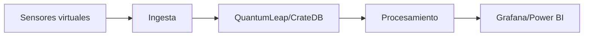

# Proyecto 3 · Título del proyecto

## Descripción y objetivo

Simular una ciudad inteligente (Smart City) con la plataforma FIWARE, integrando sensores virtuales para la captura, almacenamiento y visualización de datos en tiempo real, replicando un entorno urbano digitalizado analizable con herramientas de inteligencia de negocio.

## Arquitectura

