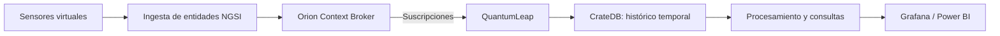

# Proyecto 3 · Smart City con FIWARE

> Proyecto del módulo Big Data aplicado. Simulación de sensores urbanos y análisis de sus datos mediante el ecosistema FIWARE.

## Descripción y objetivo

Simular una ciudad inteligente (Smart City) con la plataforma FIWARE, integrando sensores virtuales para la captura, almacenamiento y visualización de datos en tiempo real, replicando un entorno urbano digitalizado analizable con herramientas de inteligencia de negocio.

El objetivo es representar el estado de los sensores como entidades de contexto, conservar su evolución temporal y construir visualizaciones que permitan analizar el comportamiento del entorno simulado.

**Estado actual:** estructura inicial del repositorio, configuración de exclusiones y directorios de datos preparados. Todavía no hay simuladores, servicios FIWARE desplegables, transformaciones ni dashboards versionados.

## Arquitectura

*Arquitectura objetivo, pendiente de despliegue. Orion gestionará el contexto actual y QuantumLeap enviará los cambios suscritos al almacenamiento histórico en CrateDB. La herramienta de visualización definitiva se decidirá al desarrollar el dashboard.*

## Fuentes de datos

| Fuente | URL / origen | Formato | Frecuencia de actualización | Licencia / condiciones de uso | Última ingesta |
| --- | --- | --- | --- | --- | --- |
| Sensores urbanos virtuales | Simulador local pendiente de implementar | Entidades JSON compatibles con NGSI | Periódica, con intervalo por definir | Datos sintéticos generados para la práctica, sin información personal real | Pendiente |

Los tipos de sensores, sus unidades, identificadores y rangos de valores se documentarán al implementar el simulador. No se ha integrado todavía ninguna fuente externa.

## Estructura del repositorio

| Carpeta / archivo | Contenido y estado |
| --- | --- |
| `ingesta/` | Carpeta local reservada para el simulador y el envío de entidades a FIWARE |
| `etl/` | Carpeta local reservada para limpieza, transformaciones y consultas |
| `dashboard/` | Carpeta local reservada para paneles de Grafana o informes de Power BI |
| `data/raw/` | Datos originales de la simulación; actualmente solo contiene `.gitkeep` |
| `data/staged/` | Datos intermedios; actualmente solo contiene `.gitkeep` |
| `data/curated/` | Datos preparados para análisis; actualmente solo contiene `.gitkeep` |
| `.env.example` | Plantilla de variables de entorno, actualmente vacía |
| `.gitignore` | Exclusiones para datos, credenciales, entornos Python, notebooks y volúmenes locales |
| `README.md` | Descripción, arquitectura y seguimiento de la práctica |

**Nota:** `ingesta/`, `etl/` y `dashboard/` están vacías localmente y no se versionan todavía. Git solo mostrará estas carpetas cuando contengan archivos o un `.gitkeep`. No existe aún un `docker-compose.yml` en este proyecto.

## Cómo desplegar el entorno

### Preparación disponible

La versión actual permite revisar la documentación y la estructura, pero **todavía no permite arrancar la plataforma FIWARE**. No se debe ejecutar `docker compose up` desde este proyecto hasta disponer de un archivo Compose.

Para el despliegue previsto se necesitarán:

- Docker Engine o Docker Desktop y Docker Compose v2.
- Un archivo Compose con Orion, su base de datos de soporte, QuantumLeap y CrateDB.
- Variables de entorno y puertos documentados en `.env.example` cuando se definan los servicios.
- Un simulador y las suscripciones de Orion necesarias para enviar los cambios a QuantumLeap.

### Secuencia prevista de puesta en marcha

1. Definir las imágenes, versiones, redes, volúmenes y puertos de los servicios.
2. Completar `.env.example` sin credenciales y preparar la configuración local en `.env`.
3. Arrancar los servicios y comprobar sus endpoints de estado.
4. Crear las entidades y suscripciones, y ejecutar el simulador.
5. Comprobar que los cambios quedan registrados en CrateDB antes de conectar el dashboard.

Los comandos exactos y las pruebas de conectividad se incorporarán cuando exista la configuración ejecutable; no se dan por realizados estos pasos.

## Bitácora de prácticas

### Bloque 0 · Entorno

- **Objetivo:** preparar un repositorio independiente y una estructura para la práctica de Smart City.
- **Pasos realizados:** creación del README, `.env.example`, `.gitignore` y directorios `data/raw/`, `data/staged/` y `data/curated/` con `.gitkeep`.
- **Problemas encontrados y solución:** Git no conserva carpetas vacías; se han añadido `.gitkeep` a los directorios de datos. Las carpetas de código siguen pendientes de contenido versionado.
- **Resultado:** base documental y organización de datos disponibles; despliegue FIWARE pendiente.

### Bloque 1 · Simulación e ingesta en tiempo real

- **Objetivo:** generar lecturas sintéticas y actualizar entidades de contexto en Orion.
- **Pasos realizados:** pendientes de implementar el simulador y definir el modelo de entidades.
- **Problemas encontrados y solución:** pendientes de registrar durante las pruebas.
- **Resultado:** pendiente de verificar el envío y la consulta de lecturas.

### Siguientes bloques · Histórico y visualización

- **Objetivo:** conservar las series temporales mediante QuantumLeap y CrateDB y analizarlas en un dashboard.
- **Pasos realizados:** pendientes de despliegue, configuración de suscripciones y diseño de paneles.
- **Problemas encontrados y solución:** pendientes de registrar.
- **Resultado:** pendiente de comprobar la persistencia histórica y la actualización de las visualizaciones.

## Decisiones técnicas

| Decisión | Alternativa considerada | Motivo |
| --- | --- | --- |
| Sensores virtuales | Sensores físicos | Permiten generar datos reproducibles sin depender de hardware |
| FIWARE como plataforma objetivo | Envío directo de lecturas a una base de datos | Permite trabajar con entidades de contexto y suscripciones |
| Orion para contexto y QuantumLeap con CrateDB para histórico | Conservar únicamente el último estado de cada sensor | El análisis temporal requiere guardar la evolución de las lecturas |
| Separar ingesta, procesamiento y visualización | Un único componente para todo el flujo | Facilita comprobar cada etapa y sustituir componentes de forma independiente |

Estas decisiones describen el diseño previsto; no implican que los servicios estén ya configurados.

## Incidencias resueltas

| Incidencia | Solución / estado |
| --- | --- |
| Faltaba la estructura del repositorio en el README | Se incorpora la tabla de carpetas y archivos con su estado real |
| La revisión señalaba la ausencia de un `.gitignore` adecuado | El archivo actual ya contempla datos, credenciales, entornos Python, notebooks y volúmenes locales |
| Los directorios de datos vacíos no aparecían en Git | Ya incluyen `.gitkeep` versionados |

**Pendiente:** versionar las carpetas de código cuando tengan contenido y añadir la configuración ejecutable de FIWARE. No se han registrado todavía incidencias de ejecución de la plataforma porque el despliegue no está implementado.
